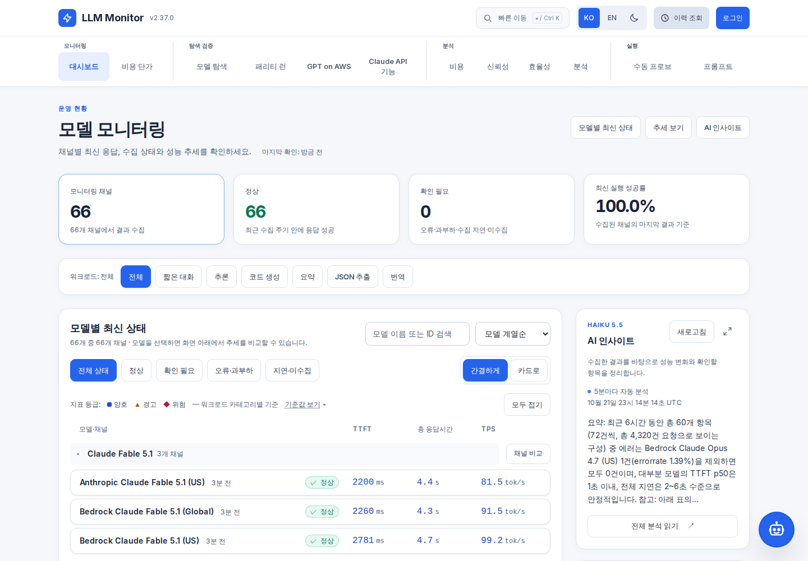
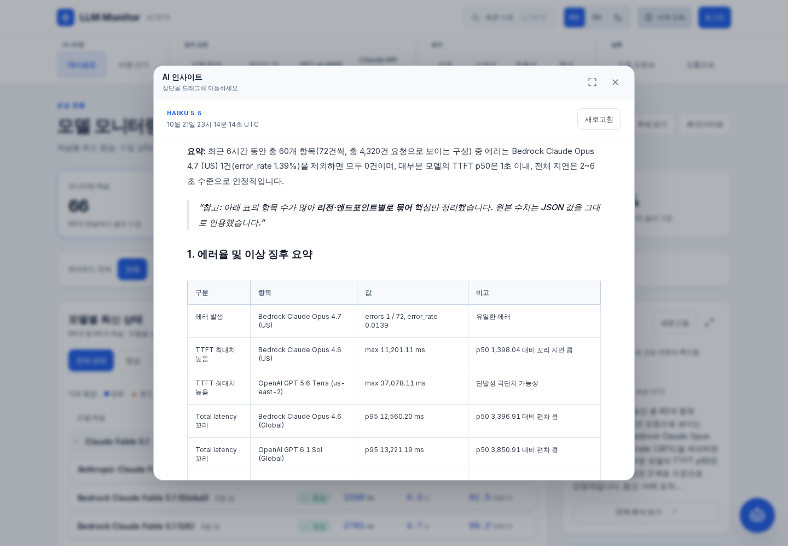
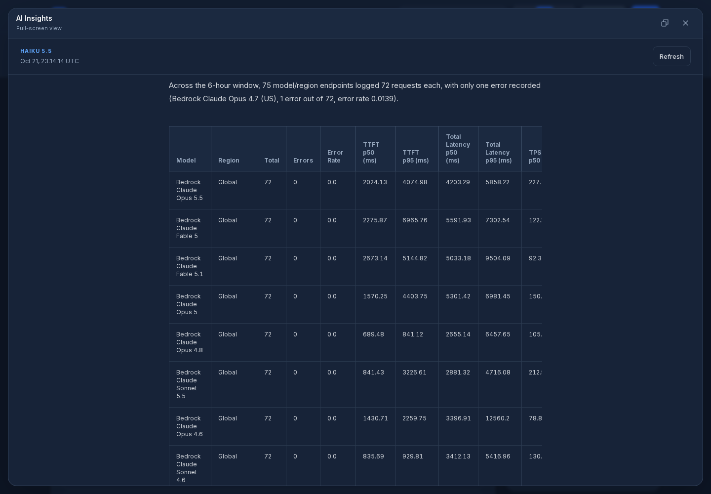
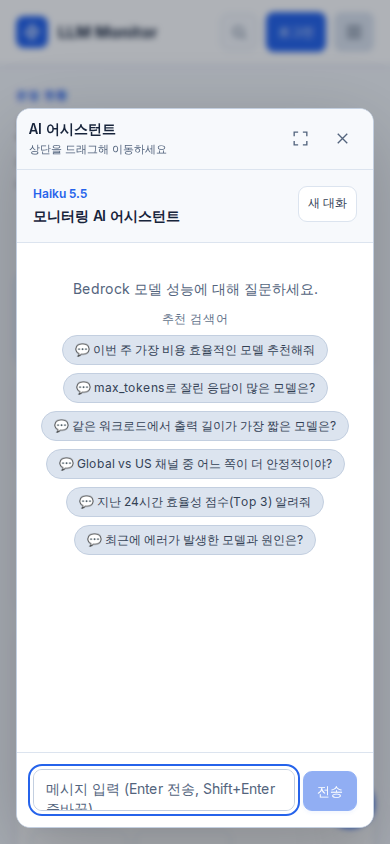

# 공개 AI와 플로팅 분석 화면 — v2.37.0

사용자가 요청한 Haiku 5.5 전환, 로그인 없는 챗봇·인사이트 조회, 인사이트 플로팅 창과 상단 메뉴 균형을 구현했다.

## 변경 내용

- 챗봇 답변·후속 질문·자동 및 수동 인사이트는 `global.anthropic.claude-haiku-5-5`를 사용하며 temperature를 보내지 않는다.
- 인사이트의 새로고침은 공개된 최신 결과 조회다. 전체 분석은 드래그 가능한 창으로 열며 전체 화면 전환, 크기 복귀, Esc 닫기와 포커스 복귀를 지원한다. 새 분석 생성은 로그인 사용자에게 별도 버튼으로 제공한다.
- 비회원 챗봇은 서명된 HttpOnly 쿠키로 대화를 구분한다. 회원은 계정별 해시 actor를 사용하고 다른 사용자와 대화를 공유하지 않는다. 세션 ID만 복사해서 다른 사용자 기록을 조회할 수 없다.
- 정상 완료에도 세션 ID를 반환하고 AgentCore 기록에 시각을 제공하며 조회 시 메시지 본문을 요청한다. 연결 종료·초기화·창 닫기 뒤의 응답을 구분한다.
- 헤더·메뉴·본문·푸터는 같은 너비와 좌우 여백으로 정렬한다. 1000px 아래에서는 두 열 모바일 메뉴를 제공하고 데스크톱 그룹은 너비에 따라 한두 줄로 배치한다.

## 검증

| 검사 | 결과 |
| --- | --- |
| `make verify` | 통과 |
| CDK 린트·타입·합성 / Jest | 통과 / 91개 |
| 백엔드 Ruff / pytest | 통과 / 1,650개 통과, PostgreSQL 조건부 18개 건너뜀 |
| 프런트엔드 타입 / Vitest | 통과 / 378개 |
| 공개 AI·기존 UI Chromium/WebKit 회귀 | 30개 통과, Safari 별도 팝업 경로 때문에 2개 건너뜀 |
| 320~1920px 한국어·영어 화면 | 26개 배치 검사, 가로 넘침·JavaScript 오류 없음 |
| 서울 Bedrock 실제 호출 | Haiku 5.5 ACTIVE, 도구 요청과 도구 결과 응답 모두 HTTP 200 |
| 별도 코드 검토 | 태블릿 로그인 헤더 겹침을 수정한 뒤 남은 차단 항목 없음 |

태블릿 헤더는 단순 가로 넘침 검사로 발견되지 않는 로고 겹침이 있어 실제 좌표를 비교했다. 긴 계정명으로 768·820·1024px를 회귀 검사하고, 768·820·999·1000·1024·1280px에서는 별도 검토로 간격을 확인했다. 공개 채팅의 비회원별·회원별 기록 분리, 위조 쿠키, Origin 검사, 요청 제한, 세션 ID 범위와 기존 인사이트 생성 인증을 백엔드 테스트로 확인했다.

브라우저 회귀 테스트는 모의 API를, 배치 검사는 저장한 공개 조회 응답을 사용했다. 배포 후에는 실제 공개 API와 브라우저로 아래 항목을 확인했다.


## 최종 운영 반영

- 버전: `v2.37.0`. 최종 애플리케이션 커밋은 `b908a9e`이며 프런트엔드 소스는 `6d662bf` 이후 동일하다.
- `make verify`를 최종 설정에서 다시 통과했다: CDK 91개, 백엔드 1,650개, 프런트엔드 378개. 최종 백엔드 운영 이미지의 Python 3.11에서도 1,650개 통과·조건부 18개 건너뜀을 확인했다.
- 프런트엔드 운영 이미지의 전체 Chromium·WebKit 검사는 195개 통과·2개 건너뜀이다. 로그인 계정명 표시와 새 태블릿 메뉴 동작까지 반영한 결과다.
- 실제 사이트의 데스크톱·모바일 한국어·영어 네 가지 조합에서 공개 인사이트 조회, 플로팅 창, 전체 화면과 크기 복귀, 비회원 챗봇 진입을 확인했다. JavaScript 오류와 가로 넘침이 없었고 네 조합 모두 RUM POST 200을 관측했다. 자동 브라우저 검증은 접속 집계를 모의 응답으로 처리했고 실제 집계 API는 별도로 확인했다.
- 운영에서 서명 쿠키를 받은 비회원의 두 번째 질문이 이전 대화 내용을 기억했다. 다른 브라우저가 세션 ID를 복사해도 첫 브라우저의 내용을 조회하지 못했다. 인사이트 생성 POST는 비회원에게 401을 반환한다.
- `BedrockMonitor-AppServices`와 `BedrockMonitor-Scheduler`는 `UPDATE_COMPLETE`이고 서비스 컨테이너의 실행 digest가 배포값과 일치한다. 예약 작업 여섯 개의 실행 주기·상태는 유지했다.
- 누적 접속수는 10,002로 유지됐으며 서버의 초기값 10,000도 보존됐다. CloudFront 캐시 갱신 `IBA79Z7V7GS48HLN9YYQQO6IT5`가 완료됐다.

### 인사이트 출력 완성 확인

첫 운영 생성에서 8,192토큰 한도로 요약이 잘리는 것을 확인해 인사이트 전용 설정을 보완했다. 자동·수동 인사이트는 확장 추론을 끄고 공통 `INSIGHTS_MAX_TOKENS=16384`를 사용한다. 프롬프트와 180초 호출·240초 태스크 제한, 챗봇·후속 질문의 요청 설정은 유지한다.

최종 예약 작업 정의 `Insights:69`를 검증용으로 한 번 실행해 인사이트 `41090`를 저장했다. 한국어 3,464자, 영어 8,657자가 모두 `end_turn`으로 종료했고 태스크 종료 코드는 0이었다.

### 이미지와 작업 정의

| 대상 | 태그 | 작업 정의 리비전 |
| --- | --- | --- |
| 백엔드 | `vb908a9e` | 90 |
| 프런트엔드 | `v6d662bf` | 96 |
| AutoProber | `vb908a9e` | 76 |
| FeaturesVerify | `vb908a9e` | 27 |
| GptBench | `vb908a9e` | 38 |
| Insights | `vb908a9e` | 69 |
| ParityRun | `vb908a9e` | 49 |
| PricingSync | `vb908a9e` | 15 |

모든 백엔드 작업은 같은 digest를 사용한다.

```text
Backend: 061525506239.dkr.ecr.ap-northeast-2.amazonaws.com/bedrock-monitor-backend-v2:vb908a9e@sha256:cb36381bd30f5191f80faf4f598413cfaf2ccee597ac5fa3a62d5985aaf31c22
Frontend: 061525506239.dkr.ecr.ap-northeast-2.amazonaws.com/bedrock-monitor-frontend:v6d662bf@sha256:46ee9b5895aa0266c1ccf63fc563a818c9c201f4565a30faf7066ba305421bd1
```


## 운영 화면








