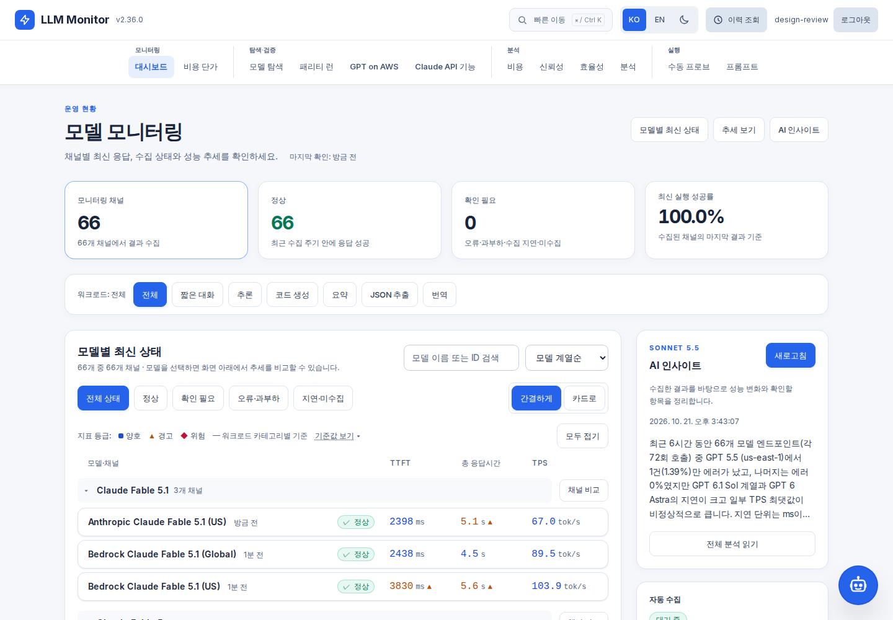
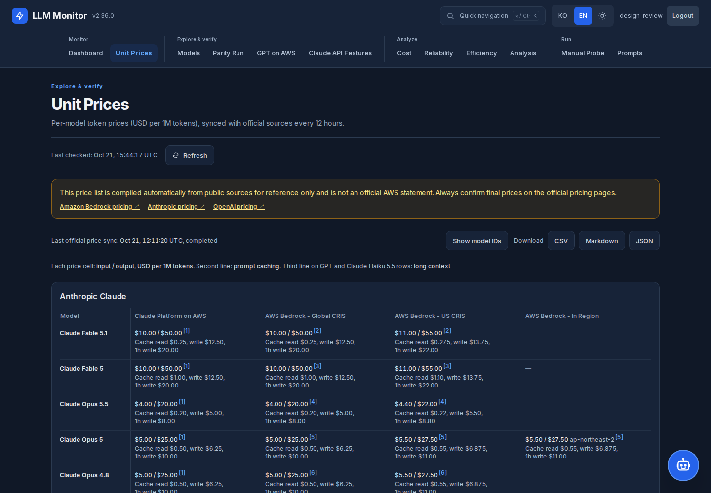
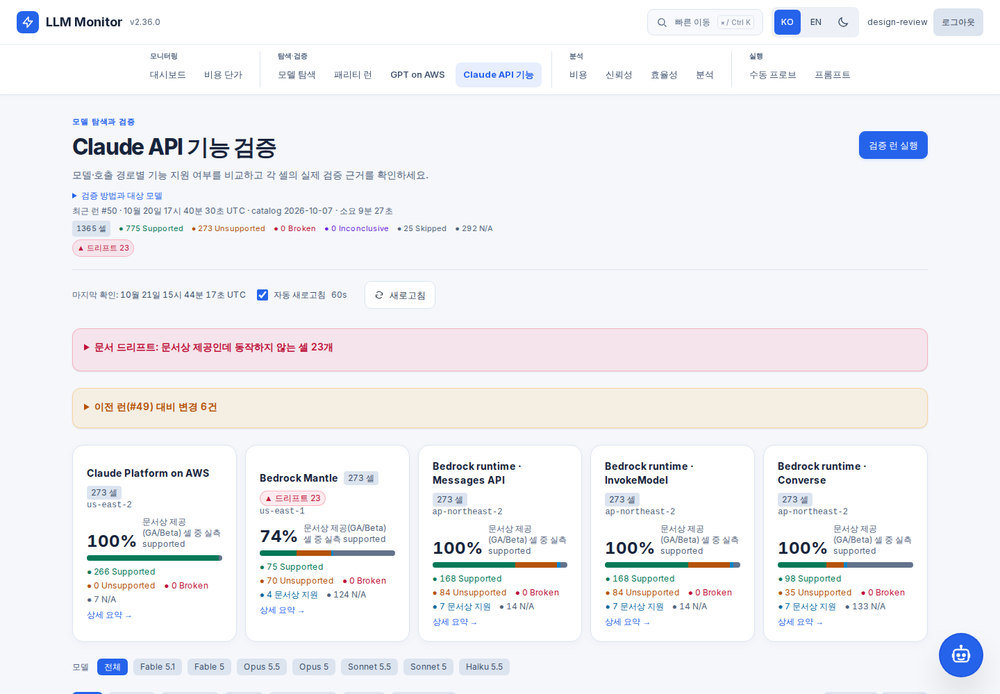
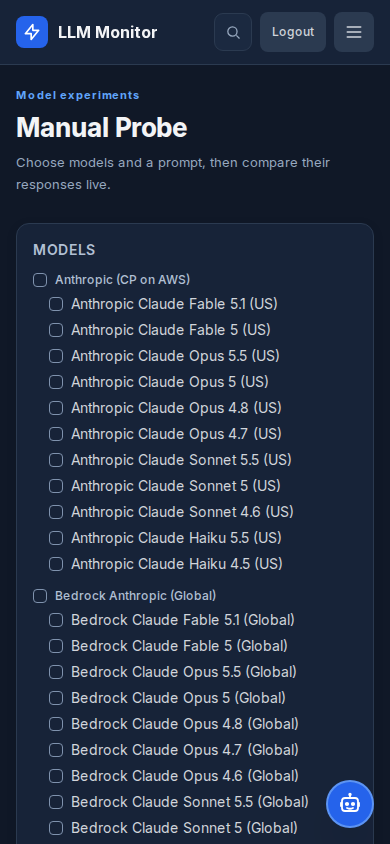
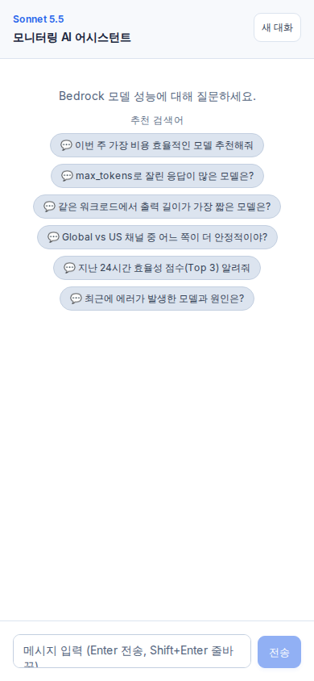
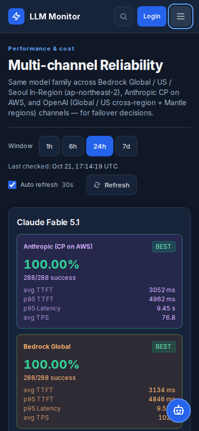

# 웹사이트 사용성 개편 — v2.36.0

기준 코드: `bc34c77` → `b58fd11`. 공통 디자인부터 대시보드, 분석, 탐색·검증, 수동 실행, 프롬프트와 챗봇까지 13개 화면을 재구현했다.

## 달라진 사용 흐름

| 영역 | 개선 내용 |
|---|---|
| 공통 탐색 | 가운데 정렬 메뉴, 현재 위치 표시, Ctrl/Cmd+K 페이지 검색, 모바일 메뉴 |
| 공통 화면 | 제목·설명·필터·갱신 정보의 위치 통일, 읽기 쉬운 카드·표·입력, 큰 화면 폭과 챗봇 여유 공간 |
| 대시보드 | 요약 뒤에 모델 결과를 배치하고 수집·주의 채널·AI 분석을 보조 영역으로 이동. 검색·필터를 압축하고 모바일 설명을 정돈 |
| AI 분석 | Sonnet 5.5 분석 미리보기와 전체 읽기, 조회 실패·빈 결과 구분, 재시도와 생성 오류 표시 |
| 비용·신뢰성·효율성·출력 분석 | 같은 구조의 조회 기간·갱신 영역·요약 카드·상세 비교 |
| 모델 탐색·단가 | 검색과 필터, 모델 카드·코드·가격표의 읽기 흐름과 글자 크기 개선. 기존 출처·단가·내보내기 유지 |
| 패리티·Claude 기능·GPT 벤치 | 긴 검증 방법과 변경·드리프트 목록을 펼쳐 읽기. 개수는 항상 표시하고 근거 접근 유지 |
| 수동 프로브·프롬프트 | 설정과 결과를 나눈 작업 화면, 일관된 폼·결과·이력 |
| 로그인·챗봇 | 작은 화면에 맞는 대화상자, 포인터로 이동하는 챗봇, 키보드 포커스 유지·복귀와 접힌 근거 열기 |

## 테마와 보존 계약

새 방문자는 라이트 테마로 시작하고 기존에 저장된 다크·라이트 선택을 우선한다. 탭 간 동기화, 초기화 중 변경, 저장소 쓰기 차단을 처리한다. 한국어 기본과 영어, PWA 안전 영역, 모델 선택·필터의 URL 상태를 유지한다.

모델 카탈로그, 인증, 수집 주기, 지표 등급, 단가 계산과 접속 집계의 의미는 바꾸지 않았다. AI 모델은 Sonnet 5.5, 후속 질문은 Haiku 4.5다. 접속수 초기값 안내 문구를 다시 넣지 않았다.

## 검증

| 검사 | 결과 |
|---|---|
| `make verify` | 통과 |
| CDK Jest | 91개 통과 |
| 백엔드 pytest | 1,633개 통과, 조건부 18개 제외 |
| 프런트엔드 Vitest | 374개 통과 |
| 실제 Python 3.11 운영 이미지 | 1,633개 통과, 조건부 18개 제외 |
| 실제 프런트엔드 운영 이미지, Chromium·WebKit | 178개 통과, Safari의 별도 팝업 방식에 해당하는 인라인 챗봇 검사 1개 제외 |
| 운영 응답 스냅샷을 이용한 52개 화면 조합 | 13개 경로 × 데스크톱/모바일·한국어/영어·라이트/다크 조합, 가로 넘침·JavaScript 오류 0건 |
| 독립 구현 검토 | 명세·코드 품질 통과. 접힌 검증 근거의 키보드 접근 문제 수정 후 두 브라우저에서 재검증 |
| 공개 운영 사이트 | 1440px·390px, 한국어·영어, 테마, 페이지 검색, 데이터 조회 정상. RUM POST 200 확인 |

개발 서버의 캐시 헤더와 HMR 반대편 HTTP 프록시 때문에 실패했던 캐시·방문자 쿠키 검사는 실제 운영 이미지에서 통과했다. 글꼴 크기에 묶여 있던 단가 검사는 가격·구조·줄바꿈 단위의 의미 검증을 유지하도록 바꿨다. 수집 주기·지표 색·표/챗봇 겹침 검사는 보존했고, 설정 패널의 헤더 아래 20px 간격을 새 배치 기준으로 확인했다.

## 운영 반영

애플리케이션과 여섯 예약 작업에 같은 백엔드 이미지를 적용했다. 이미지 태그는 `vb58fd11`이며 배포 URI에 digest를 명시했다. RUM은 활성 설정을 빌드 시 주입했다.

| 서비스 | 실행 태스크 |
|---|---|
| Backend | `BedrockMonitorAppServicesBackendTaskDef81C53F03:88` |
| Frontend | `BedrockMonitorAppServicesFrontendTaskDefB3083787:95` |

| 예약 작업 | 태스크 정의 |
|---|---|
| AutoProber | `BedrockMonitorSchedulerAutoProberTaskDefF8B95086:74` |
| FeaturesVerify | `BedrockMonitorSchedulerFeaturesVerifyTaskDefB877A261:25` |
| GptBench | `BedrockMonitorSchedulerGptBenchTaskDef508F5197:36` |
| Insights | `BedrockMonitorSchedulerInsightsTaskDef9396CE7C:67` |
| ParityRun | `BedrockMonitorSchedulerParityRunTaskDef145BF819:47` |
| PricingSync | `BedrockMonitorSchedulerPricingSyncTaskDef13AE49A5:13` |

- Backend digest: `sha256:a6853368c01c923e5092e7fd72ebe3308c15118e506802526c9502d3080ea25e`
- Frontend digest: `sha256:408e602f219969a5f1fd166c8a71d6dca45fd7c0fb7583fc60c7cb94076f435f`
- CloudFront 무효화: `I1J411FKNNLITKCHOKGICWB7X4`, 완료
- 누적 접속수: 배포 전 10,002 → 배포 후 10,002. 초기값 10,000 유지

## 화면

아래 화면은 실제 배포 이미지에 공개 조회 응답의 동일 스냅샷을 주입해 검증한 결과다. 데이터 기준 시각은 고정했고 로그인 표시는 검증용이다. 마지막 모바일 화면은 공개 운영 사이트에서 확인했다.

## 구현 판단 기록

- 사용자 요청에 따라 전체 UI를 개편하고, 앞서 요청한 가운데 정렬 메뉴를 유지했다.
- 기본 테마 선호를 선택할 기회를 제공한 뒤 라이트를 기본안으로 진행했다. 저장된 선택을 우선하고 두 테마를 지원한다.
- 관리 도구의 분리된 작업 영역을 사용해 기존 작업 파일을 보존했다. 보조 구현 실행이 서비스 오류로 중단되어 직접 구현했으며 독립 코드 검토는 별도로 완료했다.
- 배포·푸시 권한은 기존 세션의 승인 범위로 처리했다. ECR 업로드 자동 검토가 대상 확인을 요구했을 때 실제 운영 계정·저장소의 소유권과 사용 상태를 읽기 전용으로 확인했고, 동일 비공개 저장소임을 증명한 뒤 승인된 업로드를 진행했다.

설계와 구현 범위는 [설계서](../superpowers/specs/2026-10-21-usability-redesign.md), [구현 계획](../superpowers/plans/2026-10-21-usability-redesign.md)에 기록했다.
